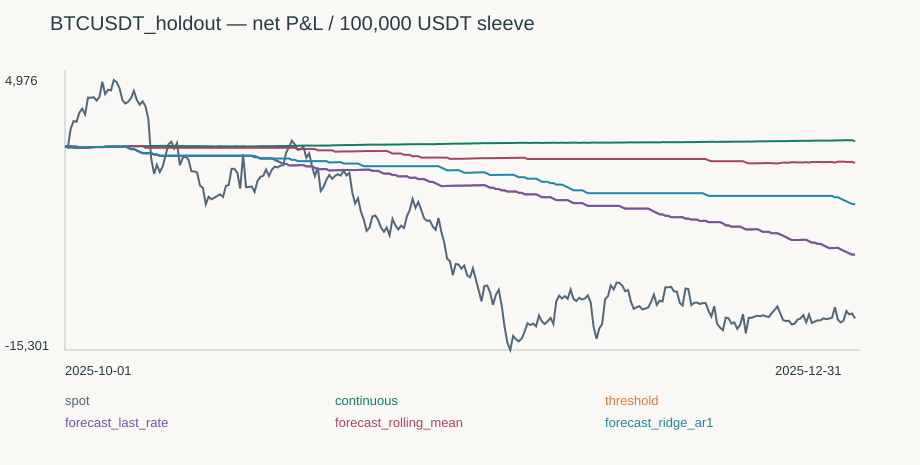

# Crypto Carry & Execution Lab

**A funding filter can spend more on switching than it earns in funding.** This project traces that mechanism through two-leg accounting, causal forecasts, capital allocation and isolated-margin stress.

[Dashboard](https://thvh2006.github.io/crypto-carry-execution-lab/) · [Research report](reports/results/P3_Crypto_Carry_Research_Report.pdf) · [Decision memo](reports/results/P3_Decision_Memo.md) · [Excel model](deliverables/excel/P3_Carry_Review.xlsx)

**Release 0.3:** polished historical research, with unchanged frozen 2025 outcomes. **Forward paper is blocked by provider HTTP 451 on the hosted runner; scheduling is disabled.** See [status](docs/STATUS.md) and [release notes](docs/RELEASE_NOTES.md).

## What the study found

October-December 2025 historical holdout. Each asset/policy starts flat with **100,000 USDT** of total capital and targets 55% matched spot exposure. Fills use hypothetical eight-hour bar-open references with commissions and adverse slippage. Idle cash and collateral remain in the denominator.

| Policy | BTC net P&L (USDT) | ETH net P&L (USDT) |
|---|---:|---:|
| Continuous carry | 374.27 | 311.46 |
| Last-settled-rate threshold | -8,137.40 | -10,252.43 |
| Nine-period mean forecast + threshold | -1,255.39 | -1,147.12 |
| Ridge AR(1) forecast + threshold | -4,334.24 | -3,858.67 |
| Continuous carry at cost x3 | 3.44 | -48.05 |

Smoother forecasts reduce switching losses relative to the naive filter. Neither forecast strategy beats continuous carry in this holdout. Even continuous carry has little room for larger friction or opportunity cost. Negative results and execution limits are retained; this is not a deployable-edge claim.



## Explore the evidence

| Deliverable | What to inspect |
|---|---|
| [Interactive dashboard](https://thvh2006.github.io/crypto-carry-execution-lab/) | Select asset, partition and all six policy variants; inspect attribution, forecasts, cost runs and historical data health; download derived account rows |
| [Excel workbook](deliverables/excel/P3_Carry_Review.xlsx) | Review selectors across 36 sleeves; Scenario cash/collateral build; native fee/slippage Data Table; historical cost fragility; source-linked charts and audit |
| [Report](reports/results/P3_Crypto_Carry_Research_Report.pdf) | Fixed research design, net economics, uncertainty, descriptive regimes, margin and operational limits |
| [Decision memo](reports/results/P3_Decision_Memo.md) | Decision, supporting evidence, failed gates and next research step |

Read the four executed notebooks in order:

1. [Contract and data audit](notebooks/01_contract_and_data_audit.ipynb): coverage, timestamp decisions, funding/basis distributions, monthly regimes and persistence.
2. [Ledger and baselines](notebooks/02_two_leg_ledger_and_baselines.ipynb): executable engine case, accounting bridge, historical attribution and turnover.
3. [Forecasts and frictions](notebooks/03_funding_forecasts_and_costs.ipynb): past-only cutoffs, future-data mutation check, forecast errors, costs, delays and paired uncertainty.
4. [Margin and operations](notebooks/04_margin_and_execution_stress.ipynb): independent stress cases, execution mismatch, paper initialization and retained access incident.

## Research controls

Official public Binance snapshots contain **1,095 funding events and 1,095 spot/perp/mark bars per asset**, calendar 2025, with no missing/duplicate nominal event. January BTC archive/API timestamps and rates match 93/93; both share a provider.

Development is Jan-Jun, validation Jul-Sep, historical holdout Oct-Dec. Source/input/configuration hashes were frozen before the first strategy-return inspection. Each partition resets capital and closes its final position. The original **13,140 event rows** reconcile to below 1e-9 USDT. Cost x1/x2/x3, delays of 1/2/3 observations, paired seven-day block intervals and operational stresses accompany the policy results.

Original run: `eed008040d6c6d18`. Release 0.3 descriptive regime/turnover analysis explains a consumed holdout; it does not retune the model or create another untouched test. Original economic source is preserved under `artifacts/market/frozen_source/`.

## Run locally

### Public review path - no network or private data

Python 3.9+. Engine/tests/notebook generation use the standard library.

```sh
git clone https://github.com/thvh2006/crypto-carry-execution-lab.git
cd crypto-carry-execution-lab
python3 -m unittest discover -s tests -v
python3 -m carry.run demo
python3 scripts/build_notebooks.py
```

This verifies engine behavior and regenerates the evidence notebooks from published aggregates and deterministic cases. It does **not** reconstruct the complete market ledger from raw provider data.

### Original market replay

Place the preserved private snapshot under `data/market/`, then:

```sh
python3 -m carry.reproduce --verify-only
python3 -m carry.reproduce --out artifacts/reproduction
```

Python 3.9.6 reproduces all seven CSVs byte-for-byte. On newer Python, floating-point summation can alter forecast-error summaries at machine precision. An explicit `--allow-numeric-equivalence` run checks fixed absolute 1e-9 / relative 1e-12 tolerances and labels differences instead of claiming byte identity. In the checked Python 3.12 run, only forecast-error CSV bytes differed; maximum numeric difference was approximately 6.8e-21.

Original artifacts are never overwritten. Changing a consumed study requires a new protocol/version, not deleting its freeze. See [runbook](docs/RUNBOOK.md).

### Optional public reacquisition

```sh
python3 -m carry.acquire --install-equivalent
```

Where provider access is permitted, this paginates official endpoints into a new private directory, audits coverage, and installs normalized CSVs **only if their hashes match the frozen snapshot**. New receipts remain separate. Provider revisions require separate review; HTTP 451 stops collection. This optional path is not claimed to work from the blocked hosted environment.

## Structure

| Path | Role |
|---|---|
| `carry/` | Accounting, adapters, forecasting/replay, reproduction, paper and presentation helpers |
| `tests/` | Economic, temporal, reconciliation, failure and reproduction regression checks |
| `artifacts/market/` | Original frozen aggregate results, source archive and receipts |
| `artifacts/review/` | Explicitly post-study descriptive diagnostics and derived account curves |
| `notebooks/` | Executed research narratives with tables and figures |
| `deliverables/excel/` | Formula-driven review workbook |
| `dashboard/` | Static research interface template |
| `docs/` | Method, data contract, runbook, release status and change history |
| `reports/results/` | English report and memo |

## Assumptions and limits

Base costs are 10 bps spot / 5 bps perp per side plus 2 bps adverse slippage. These deliberately explicit taker-style assumptions are tested at higher multiples; they are not a historical fee-tier certification. A fixed 0.5 bps funding threshold is an untuned baseline. Capital uses 65% spot-wallet cash, 35% isolated collateral and 55% desired matched notional, leaving a cost/collateral reserve; this allocation is not optimized.

Funding settles on old holdings before a later target executes. Actual funding times match nominal eight-hour bar opens up to 16 ms earlier. Those prices are hypothetical execution references. Flat maintenance, current contract filters, full modeled closes and OHLC margin proxies cannot prove historical fill capacity or venue-exact liquidation survival. USDT/USD depeg is a separate scenario.

Raw/normalized provider snapshots and price-level ledgers are excluded from the public export; no unrestricted redistribution license is asserted. Public trajectories and workbook History contain derived account values. Code licensing is [not yet selected](LICENSE_NOTICE.md).

Report authoring requires ReportLab and installed Times New Roman fonts. Workbook authoring uses the provided artifact runtime; the PDF/XLSX open independently. [Environment record](environment.json) and [runbook](docs/RUNBOOK.md) describe the build requirements.

The read-only paper collector retains epochs, intended targets, simulated fills and reconciliation receipts. It has no authenticated or order endpoint. The hosted access failure is retained, and no successful forward state or performance is claimed.
